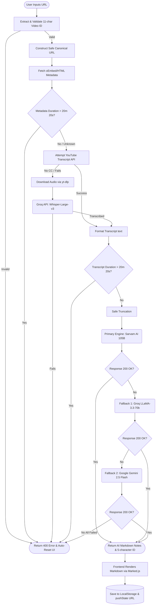

<h1 align="center">Veda AI - Video Lecture Analyzer</h1>

<p align="center">
  <strong>Convert long, unstructured YouTube educational videos into highly structured, comprehensive teacher notes using advanced Large Language Models.</strong>
</p>

---

## 🧠 The Concept

**Veda AI** is designed to solve a major problem for students and self-learners: spending hours watching long lectures to extract just a few core concepts. 

Instead of manually taking notes, Veda AI automates the process by extracting the transcript of any YouTube video and feeding it through a powerful, custom-designed AI pipeline. The AI acts as a **Virtual Teacher**, breaking down the video into:
1. Core Principles & Philosophies
2. Deep-dive Analogies
3. Actionable Applications
4. Summary & Key Takeaways

Regardless of the language spoken in the video (e.g., Hindi), Veda AI strictly formats and translates the structured notes into **English**, creating a universal study guide.

---

## ✨ Key Features

- **Clean 2D Monochrome Interface**: A modern, high-contrast Black & White UI inspired by BTechX with glassmorphism, responsive controls, and high-performance layout (no 3D overhead).
- **Dynamic URL Routing**: Just like ChatGPT, every generated note gets a unique 5-character ID (e.g., `/home/X9F2A`). This enables seamless browser navigation (Back/Forward) and session persistence.
- **Advanced Fallback AI Pipeline**: Ensures 99.9% uptime by automatically falling back across LLM engines (NVIDIA NIM Nemotron -> Sarvam -> Groq -> Gemini) if the primary engine fails.
- **Auto-Whisper Transcription**: If a video lacks YouTube subtitles, Veda AI seamlessly intercepts, downloads the audio track via `yt-dlp`, and transcribes it using Groq's lightning-fast `whisper-large-v3` model.
- **Smart History Tracking**: A collapsible sidebar that saves your lecture history locally so you never lose your notes.

---

## 🔒 Security & Stability

- **SSRF Protection**: Strict server-side validation strips malicious inputs and reconstructs a safe canonical YouTube URL (`https://www.youtube.com/watch?v=...`) before fetching data, entirely preventing Server-Side Request Forgery.
- **Path Traversal Guard**: Video IDs are strictly validated using RegEx (`^[a-zA-Z0-9_-]{11}$`) to prevent filesystem manipulation during audio downloads.
- **Duration Limiter**: An ultra-fast pre-transcript metadata check strictly limits analysis to videos under **20 minutes and 20 seconds**, preventing server timeouts and abuse. It auto-resets the UI upon rejection.
- **Safe Truncation**: To prevent token limit crashes, transcripts are securely truncated (12,000 characters for Sarvam, 24,000 for Groq) before being sent to the LLMs.
- **Robust Prompting**: Strict LLM instructional prompts prevent template bleeding (e.g., outputting literal placeholder text).

---

## 🏗️ System Architecture & Flow

Veda AI utilizes a highly resilient backend architecture designed in **Python Flask**. When a video is submitted, the system attempts to process it through a cascading chain of AI systems to guarantee a result.

### How it works (Flowchart)



### The AI Pipeline Explained:
1. **Sarvam AI (Primary)**: The primary engine, highly optimized for instruction extraction and processing Indian context/languages. (Limited to 4096 tokens).
2. **Groq (Fallback 1)**: If the Sarvam API fails or the API key is missing, the system instantly switches to Groq using `llama-3.3-70b-versatile` for ultra-fast inference (Up to 6000 tokens).
3. **Gemini (Fallback 2)**: The ultimate safety net. If Groq is rate-limited or fails, Gemini kicks in to ensure the user still gets their notes.

---

## 🛠️ Tech Stack

**Frontend:**
- HTML5, Vanilla CSS3 (High-performance 2D Monochrome Glassmorphism)
- JavaScript (Vanilla with HTML5 History API Routing)
- Feather Icons & Marked.js (Markdown Rendering)

**Backend:**
- Python 3.x
- Flask (WSGI Web Framework)
- `youtube-transcript-api` & `yt-dlp`
- `openai` (NVIDIA NIM), `groq`, `requests`, & `google-genai`

---

## 🚀 Installation & Setup

### Prerequisites
- **Python 3.8+**
- **FFmpeg**: Required for audio extraction during the Whisper transcription fallback.
  - **Windows**: Download from [gyan.dev](https://www.gyan.dev/ffmpeg/builds/) or install via `winget install ffmpeg`. Ensure it's in your system PATH or installed in common program files directories.
  - **Mac**: `brew install ffmpeg`
  - **Linux**: `sudo apt install ffmpeg`

1. **Clone the repository:**
   ```bash
   git clone https://github.com/aryavartsubhammoharana/veda-ai.git
   cd veda-ai
   ```

2. **Install dependencies:**
   ```bash
   pip install -r requirements.txt
   ```

3. **Configure Environment Variables:**
   Create a `.env` file in the root directory and add your API keys:
   ```env
   SARVAM_API_KEY=your_sarvam_key_here
   GROQ_API_KEY=your_groq_key_here
   GEMINI_API_KEY=your_gemini_key_here
   ```

4. **Run the application:**
   ```bash
   python app.py
   ```
   The application will be available at `http://127.0.0.1:5000/home`.

---

<p align="center">
  <i>Developed to make self-education faster, smarter, and visually stunning.</i>
</p>
