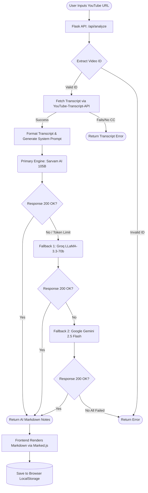

<h1 align="center">Veda AI - Video Lecture Analyzer</h1>

<p align="center">
  <strong>Convert long, unstructured YouTube educational videos into highly structured, comprehensive teacher notes using advanced Large Language Models.</strong>
</p>

---

## 🧠 The Concept

**Veda AI** is designed to solve a major problem for students and self-learners: spending hours watching long lectures to extract just a few core concepts. 

Instead of manually taking notes, Veda AI automates the process by extracting the transcript of any YouTube video and feeding it through a powerful, custom-designed AI pipeline. The AI acts as a **Virtual Teacher**, breaking down the video into:
1. Core Principles & Philosophies
2. Deep-dive Analogies
3. Actionable Applications
4. Summary & Key Takeaways

Regardless of the language spoken in the video (e.g., Hindi), Veda AI strictly formats and translates the structured notes into **English**, creating a universal study guide.

---

## ✨ Key Features

- **3D "AI-OS" Interface**: A fully immersive frontend built with Three.js, Vanta.js (Neural Network background), and VanillaTilt for interactive 3D glassmorphic cards.
- **Advanced Fallback AI Pipeline**: Ensures 99.9% uptime by automatically falling back to secondary and tertiary LLM engines if the primary engine hits a rate limit or fails.
- **Smart History Tracking**: A ChatGPT-style collapsible sidebar that saves your lecture history locally so you never lose your notes.
- **Clean Architecture**: Modular CSS and JS architecture for a lightning-fast Single Page Application (SPA) experience.

---

## 🏗️ System Architecture & Flow

Veda AI utilizes a highly resilient backend architecture designed in **Python Flask**. When a video is submitted, the system attempts to process it through a cascading chain of Large Language Models to guarantee a result.

### How it works (Flowchart)



### The AI Pipeline Explained:
1. **Sarvam AI (Primary)**: The primary engine, highly optimized for instruction extraction and processing Indian context/languages. (Limited to 4096 tokens).
2. **Groq (Fallback 1)**: If the video is too long or Sarvam fails, the system instantly switches to Groq using `llama-3.3-70b-versatile` for ultra-fast inference (Up to 6000 tokens).
3. **Gemini (Fallback 2)**: The ultimate safety net. If Groq is rate-limited, Gemini kicks in to ensure the user still gets their notes.

---

## 🛠️ Tech Stack

**Frontend:**
- HTML5, Vanilla CSS3 (Glassmorphism design)
- JavaScript (Vanilla)
- Three.js & Vanta.js (3D Animations)
- VanillaTilt.js (Card Interactions)
- Feather Icons & Marked.js (Markdown Rendering)

**Backend:**
- Python 3.x
- Flask (WSGI Web Framework)
- `youtube-transcript-api`
- `requests` & `google-genai` (API Integrations)

---

## 🚀 Installation & Setup

1. **Clone the repository:**
   ```bash
   git clone https://github.com/aryavartsubhammoharana/veda-ai.git
   cd veda-ai
   ```

2. **Install dependencies:**
   ```bash
   pip install -r requirements.txt
   ```

3. **Configure Environment Variables:**
   Create a `.env` file in the root directory and add your API keys:
   ```env
   SARVAM_API_KEY=your_sarvam_key_here
   GROQ_API_KEY=your_groq_key_here
   GEMINI_API_KEY=your_gemini_key_here
   ```

4. **Run the application:**
   ```bash
   python app.py
   ```
   The application will be available at `http://127.0.0.1:5000/home`.

---

<p align="center">
  <i>Developed to make self-education faster, smarter, and visually stunning.</i>
</p>
