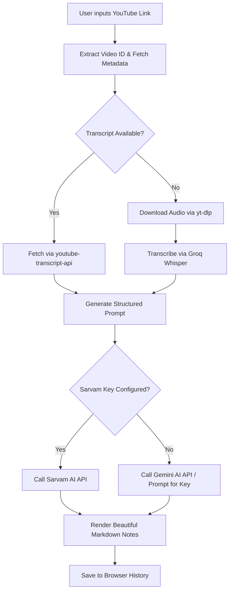

# Implementation Plan: Veda AI - YouTube Video Lecture Analyzer

This plan details the design and implementation steps for transitioning the project into a premium, state-of-the-art Web Application for analyzing YouTube video lectures using the **Sarvam AI API**.

## 1. Objectives & Workflow
- **Reset Codebase**: Clean up existing `app.py` code and build a modern Flask-based web app.
- **YouTube Input**: Take a YouTube URL, extract the video ID, and validate it.
- **Get Transcript**: 
  1. Retrieve the transcript using `youtube-transcript-api` (fastest & free).
  2. Fall back to downloading the audio via `yt-dlp` and transcribing it via **Groq Whisper** (whisper-large-v3) if no YouTube subtitles are available.
- **Sarvam AI Integration**: Send the transcript text with a tailored prompt to the **Sarvam AI API** (`sarvam-30b` or `sarvam-105b` model) to generate structured analysis.
- **Fallback Support**: Support fallback to **Gemini 2.5 Flash** if the Sarvam API key is not yet configured, ensuring out-of-the-box functionality.
- **Premium Web Interface**: Create a single-page web app with:
  - Futuristic glassmorphism design (deep purples, blues, glowing accents).
  - Floating API keys configuration panel to easily set and save keys (`SARVAM_API_KEY`, `GROQ_API_KEY`, `GEMINI_API_KEY`).
  - Interactive transcript viewer with text search.
  - Formatted lecture notes (Title, Subtitle, Headings, Subheadings, Body) with Markdown rendering.
  - History log saved in `localStorage` to access previous analyses instantly.



## 2. Technical Stack
- **Backend**: Python 3, Flask, `youtube-transcript-api`, `yt-dlp`, `requests`, `python-dotenv`.
- **Frontend**: HTML5, Vanilla CSS (Glassmorphic dark-theme, glowing transitions), Vanilla JavaScript, Markdown rendering via `marked.js`, Feather Icons (for premium graphics).
- **APIs**:
  - **Sarvam AI**: `https://api.sarvam.ai/v1/chat/completions` (Models: `sarvam-30b`, `sarvam-105b`)
  - **Groq**: Whisper Large V3 (for audio fallback)
  - **Gemini**: Gemini 2.5 Flash (for prompt fallback)

## 3. Directory Layout
```text
meta_video_analyser/
├── .env                  # API keys
├── app.py                # Flask Backend
├── templates/
│   └── index.html        # Glassmorphic Single-Page UI
└── artifacts/
    └── implementation_plan.md  # This document
```

## 4. Analysis Prompt Design
To satisfy the user's requirement for a structured, teacher-like lecture note format:
```text
Analyze the following YouTube video lecture transcript. Explain the concepts point-by-point, acting like a teacher explaining a topic to a student.

Output your response using the following structured format:
# [Main Video Title / Subject]
## [Short Subtitle / Overview]

### [Heading: Main Concept 1]
#### [Subheading: Detail/Subtopic 1a]
- [Body: Point-by-point explanation, formulas, key arguments, or examples]
- [Body: Continuing detail...]

#### [Subheading: Detail/Subtopic 1b]
- [Body: Point-by-point explanation...]

### [Heading: Main Concept 2]
...
```

## 5. Development Steps
1. **Prepare directories**: Create `templates/` folder.
2. **Implement Flask Backend (`app.py`)**:
   - Write YouTube ID extraction & metadata fetcher.
   - Write Transcript retriever (with Groq fallback).
   - Write Sarvam / Gemini API integration.
   - Write API configuration routes (updates `.env`).
3. **Design the UI (`templates/index.html`)**:
   - Write glassmorphic CSS styling.
   - Design state transitions (Idle -> Validating -> Fetching -> Analyzing -> Complete).
   - Add responsive container layout with clean visual hierarchy.
4. **Validation & Testing**:
   - Test with a short YouTube link.
   - Validate API key updates.
   - Verify layout responsive design and CSS smooth loading animations.
